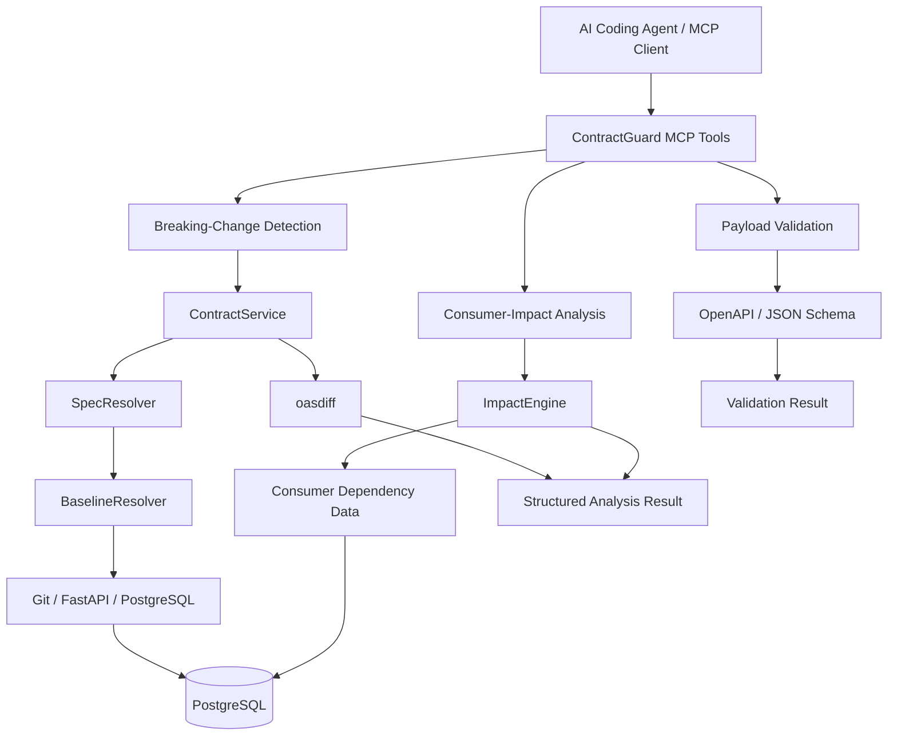
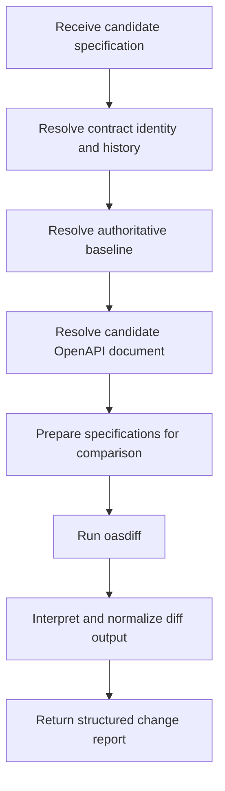
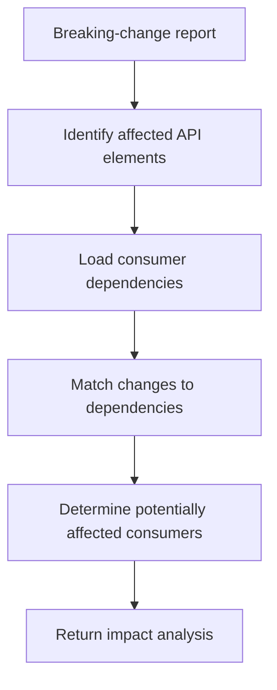
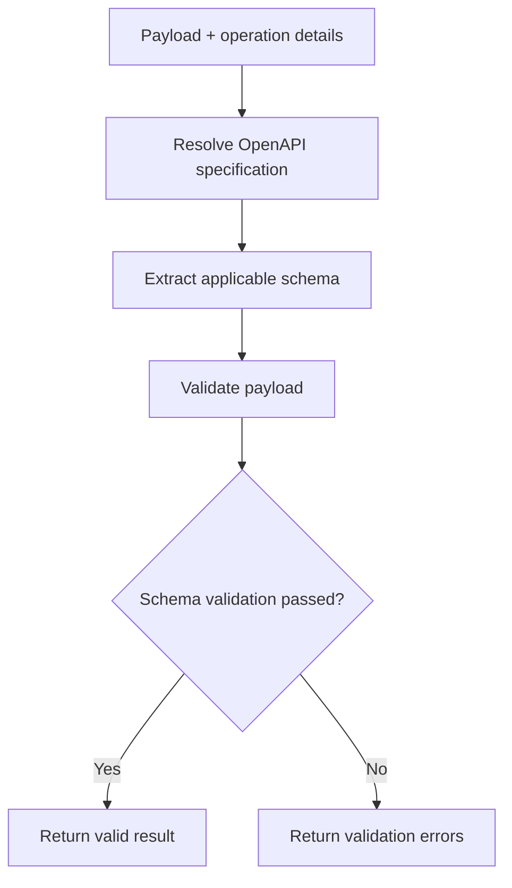

# ContractGuard — MCP-Based API Contract Intelligence Engine

**Making API changes understandable and actionable for AI agents.**

ContractGuard is an MCP-based developer tool that analyzes OpenAPI specifications to identify breaking changes, assess their potential impact on downstream API consumers, and validate payloads against API schemas. It combines Git-backed baseline resolution, PostgreSQL-based contract history and dependency data, and `oasdiff`-powered compatibility analysis to make API contract intelligence accessible through structured tools that AI agents can discover and invoke.

**Core technologies:** Python · Model Context Protocol (MCP) · OpenAPI · PostgreSQL · oasdiff · JSON Schema · Git · FastAPI

[GitHub Repository](https://github.com/yugal072/ContractGuard)

---

## Table of Contents

- [The Problem](#the-problem)
- [What ContractGuard Does](#what-contractguard-does)
- [Key Features](#key-features)
- [Architecture](#architecture)
- [Core Components](#core-components)
- [MCP Tools](#mcp-tools)
- [How It Works](#how-it-works)
- [Baseline Resolution and Contract Lifecycle](#baseline-resolution-and-contract-lifecycle)
- [Database Design](#database-design)
- [Technology Choices](#technology-choices)
- [Example Workflow](#example-workflow)
- [Testing](#testing)
- [Project Structure](#project-structure)
- [Setup and Configuration](#setup-and-configuration)
- [Limitations and Future Improvements](#limitations-and-future-improvements)

---

## The Problem

API contracts evolve as applications are developed and maintained. An apparently small change to an OpenAPI specification can introduce compatibility issues for services and applications that depend on it.

For example, removing a response field, introducing a new required parameter, or changing a schema incompatibly can break existing consumers even when the API provider's implementation continues to work.

Traditional contract-diff workflows can identify changes, but developers still need to answer several questions:

- **What changed?** Which modifications are potentially breaking?
- **What is the correct baseline?** Which version should the current specification be compared against?
- **Who is affected?** Which downstream consumers depend on the changed API operations or fields?
- **Is the payload still valid?** Does a concrete request payload conform to the API schema?
- **Can an AI agent investigate the issue?** Can these checks be performed through a standardized, machine-readable interface?

ContractGuard brings these concerns into one contract-intelligence workflow.

## What ContractGuard Does

ContractGuard exposes API contract analysis capabilities through the Model Context Protocol (MCP). Instead of requiring an AI coding agent to implement its own OpenAPI comparison and validation logic, the agent can discover and invoke dedicated tools.

The system combines four primary capabilities:

1. **Breaking-change detection** using semantic OpenAPI comparison.
2. **Consumer-impact analysis** using registered consumer dependencies.
3. **Payload validation** against OpenAPI-derived JSON schemas.
4. **Contract history and baseline resolution** using Git and PostgreSQL.

The goal is to move beyond reporting that an API has changed and provide structured information that helps developers understand the consequences of that change.

## Key Features

### 1. OpenAPI Breaking-Change Detection

ContractGuard uses `oasdiff` to compare OpenAPI specifications and identify potentially incompatible changes.

Depending on the specification changes and the rules supported by the diff engine, these can include:

- Removed API operations or endpoints.
- Newly required parameters.
- Incompatible request or response schema changes.
- Removed response properties.
- Changes to required fields or parameter constraints.

The comparison is based on API specification semantics rather than a simple line-by-line text diff.

### 2. Git-Backed Baseline Resolution

A meaningful compatibility check requires a trustworthy reference specification.

ContractGuard includes a baseline-resolution layer that can use the Git `main` worktree as an authoritative reference. It also supports resolving OpenAPI specifications from FastAPI applications and using eligible PostgreSQL contract versions as a fallback where applicable.

This separates the decision about **which specifications to compare** from the logic that actually compares them.

### 3. Consumer-Impact Analysis

Identifying a breaking change is only part of the problem. ContractGuard also models consumer dependencies to determine which downstream services or applications may be affected.

The impact-analysis workflow combines detected changes with dependency information to produce a more actionable result.

For example, if an API response field is removed, the system can use its dependency records to identify consumers associated with the affected API surface.

### 4. JSON Schema Payload Validation

ContractGuard validates concrete payloads against the applicable API schema.

This is separate from breaking-change detection:

- Breaking-change detection evaluates compatibility between specifications.
- Payload validation evaluates whether a particular payload conforms to a schema.

Validation is deterministic and schema-based rather than relying on an LLM to judge whether a payload appears correct.

### 5. PostgreSQL-Based Contract History

PostgreSQL stores structured contract data, version records, lifecycle metadata, and consumer dependency information.

This provides a persistent representation of the API contract ecosystem instead of treating every analysis as an isolated file comparison.

### 6. MCP Tool Integration

The core capabilities are exposed through dedicated MCP tools, allowing compatible AI clients to discover and invoke contract-analysis functionality through a standardized interface.

This makes ContractGuard useful as developer infrastructure within AI-assisted coding and debugging workflows.

---

## Architecture

ContractGuard separates MCP-facing tool interfaces from the underlying contract-analysis and data-resolution logic.



*The diagram represents the system's logical architecture; individual module boundaries should match the implementation in the repository.*

### Architectural Flow

1. An MCP client discovers and invokes a ContractGuard tool.
2. The tool delegates the request to the relevant service or analysis component.
3. The system resolves the required specification, baseline, dependency records, or schema.
4. The relevant engine performs compatibility analysis, impact analysis, or validation.
5. The tool returns a structured result to the MCP client.

This separation keeps the MCP interface distinct from the underlying business logic and data-access concerns.

---

## Core Components

### `ContractService`

Coordinates OpenAPI contract comparison and related processing.

Its responsibilities include preparing specifications for comparison, invoking `oasdiff`, interpreting the diff output, and returning a normalized result containing relevant change information.

Using a dedicated service layer also keeps the comparison logic reusable independently of the MCP interface.

### `BaselineResolver`

Determines which specification should serve as the comparison baseline.

It handles the distinction between an authoritative reference and a candidate or draft specification. The resolution strategy can consider Git-backed specifications and eligible persisted contract versions.

The key design principle is that the newest stored version should not automatically become the baseline merely because it exists.

### `SpecResolver`

Obtains the concrete OpenAPI specification required for an operation.

Depending on the configured workflow, the specification may come from a Git-backed source, a FastAPI application, or persisted contract data.

Keeping specification retrieval separate from baseline selection makes it easier to reason about where a document comes from and why it was selected.

### `ImpactEngine`

Processes breaking-change information alongside consumer dependency data to identify downstream consumers potentially affected by the changed API surface.

This is the component that connects contract-level changes to their implications for dependent services.

### Schema Validation

Validates payloads against the relevant OpenAPI-derived JSON Schema.

It returns validation outcomes and associated errors so that developers or AI agents can investigate malformed or incompatible payloads.

### PostgreSQL Data Layer

Maintains contract records, version history, lifecycle information, and consumer dependency data.

The relational model supports querying relationships between contracts, versions, and their consumers.

---

## MCP Tools

ContractGuard exposes the following core capabilities through MCP.

### `contractguard_breaking_changes`

**Purpose:** Detect potentially breaking changes between a candidate OpenAPI specification and its resolved baseline.

Typical use cases:

- Reviewing API changes before merging code.
- Identifying removed or incompatible API elements.
- Investigating compatibility issues after a specification changes.

Conceptual workflow:

```text
Candidate specification
          +
Resolved baseline
          ↓
   OpenAPI comparison
          ↓
   Breaking-change report
```

### `contractguard_consumer_impact`

**Purpose:** Determine which registered consumers may be affected by detected contract changes.

Typical use cases:

- Identifying downstream services that require updates.
- Prioritizing compatibility fixes.
- Understanding the reach of a breaking API change.

Conceptual workflow:

```text
Breaking changes
        +
Consumer dependencies
        ↓
  Impact analysis
        ↓
Affected consumers
```

### `contractguard_validate_payload`

**Purpose:** Validate a request payload against the applicable API schema.

Typical use cases:

- Checking whether a request body conforms to an operation's schema.
- Identifying missing required properties.
- Finding type mismatches or schema constraint violations.

Conceptual workflow:

```text
API operation + payload
          ↓
    Resolve schema
          ↓
   JSON Schema validation
          ↓
 Validation result + errors
```

The precise tool parameters and response fields are defined by the implementation and should be consulted in the current tool schemas.

---

## How It Works

### Breaking-Change Detection



The baseline and candidate are resolved before comparison so that the diff engine receives the intended specifications.

The service then interprets the comparison output and returns relevant information in a structured format.

### Consumer-Impact Analysis



The value of this workflow is the connection between a technical change and the consumers that depend on the affected API surface.

The accuracy of the result depends on the completeness and correctness of the dependency records.

### Payload Validation



Payload validation is a separate execution path and does not require an LLM to make the validity decision.

---

## Baseline Resolution and Contract Lifecycle

Choosing the correct baseline is one of the most important design decisions in ContractGuard.

Comparing a candidate specification against an arbitrary previous file can produce misleading compatibility results. For example, a draft specification should not automatically replace the last authoritative contract simply because it was stored more recently.

ContractGuard models contract versions using lifecycle states discussed during implementation:

| Status | Purpose |
|---|---|
| `draft` | A candidate version that is still being developed. |
| `approved` | A version that has passed the relevant approval stage. |
| `released` | A version designated as released. |

The exact transitions and baseline eligibility rules are determined by the implementation.

### Baseline Sources

**Git-backed source**

The Git `main` worktree provides an authoritative reference for comparison where the configured resolver supports it.

**FastAPI application**

A FastAPI application can expose its OpenAPI specification programmatically. A module-and-application target such as `module.path:app` identifies the application from which the specification can be obtained.

**PostgreSQL fallback**

Eligible stored contract versions can provide a fallback when the primary Git-backed baseline cannot be resolved, subject to the configured lifecycle rules.

The separation between `BaselineResolver` and `SpecResolver` keeps two decisions distinct:

- Which version should be treated as the baseline?
- Where should the required specification be obtained from?

---

## Database Design

ContractGuard uses PostgreSQL because contract history and consumer dependencies have relational structure.

The domain model includes the following entities:

| Entity | Responsibility |
|---|---|
| `contracts` | Identifies API contracts and stores their associated metadata. |
| `contract_versions` | Stores versioned specifications and lifecycle metadata. |
| `consumers` | Represents applications or services consuming APIs. |
| `consumer_dependencies` | Records relationships between consumers and the API surfaces they depend on. |

Conceptually, the relationships look like this:

```text
Contract
   │
   └── Contract Versions

Consumer
   │
   └── Consumer Dependencies
               │
               └── API Contracts / Operations
```

The exact foreign keys and dependency granularity should be read from the repository's database models and schema.

### Why Persistent History Matters

Persistent contract records enable the system to retain version information across analysis requests rather than relying exclusively on transient files.

Dependency records add context to compatibility reports, allowing analysis to move from detecting a changed API to investigating its potential downstream consequences.

---

## Technology Choices

| Technology | Why it is used |
|---|---|
| **Python** | Implements the core services, contract-analysis workflows, and tool logic. |
| **MCP** | Exposes contract-intelligence capabilities through discoverable, structured tools for AI clients. |
| **OpenAPI** | Provides a machine-readable representation of API operations, parameters, request bodies, and responses. |
| **oasdiff** | Performs OpenAPI-aware specification comparison and helps identify compatibility-breaking changes. |
| **PostgreSQL** | Persists contract versions, lifecycle metadata, and consumer dependency relationships. |
| **Git** | Provides a version-controlled reference for baseline resolution. |
| **FastAPI** | Supports obtaining an OpenAPI specification directly from a Python application. |
| **JSON Schema** | Enables deterministic validation of concrete payloads against API schemas. |

### Why Not a Simple Text Diff?

OpenAPI specifications are structured documents. A line-by-line comparison can flag irrelevant formatting changes while failing to explain the compatibility implications of a semantic change.

Using an OpenAPI-aware comparison engine allows ContractGuard to focus on API-level changes rather than raw textual differences.

### Why Not Use an LLM for Validation?

Schema validation is a deterministic task. A JSON Schema validator can check required properties, data types, and applicable constraints directly.

MCP provides the agent interface, while dedicated validation and comparison components perform the underlying checks.

---

## Example Workflow

Consider an API provider that originally returns the following response:

```json
{
  "id": 101,
  "total": 250.0,
  "currency": "INR"
}
```

A new API specification removes the `total` property.

A downstream billing service depends on this property to calculate invoice amounts.

A ContractGuard workflow can be organized as follows:

1. **Detect the change:** Invoke `contractguard_breaking_changes` to compare the candidate specification with the resolved baseline.
2. **Investigate the impact:** Invoke `contractguard_consumer_impact` to determine which registered consumers depend on the affected API surface.
3. **Validate a payload:** Invoke `contractguard_validate_payload` to check a concrete payload against the applicable schema.
4. **Use the results:** The AI coding agent can use the structured findings to help the developer investigate the compatibility issue and determine the necessary changes.

This example illustrates the intended workflow. The actual output depends on the registered specifications, dependency records, tool arguments, and validation rules.

---

## Testing

ContractGuard has been developed with automated testing using `pytest`.

Payload-validation tests were run successfully during development, with a recorded result of **2 out of 2 tests passing** for that test subset.

The project should maintain tests covering the following areas as the implementation evolves:

- Valid and invalid payloads.
- OpenAPI comparison and breaking-change interpretation.
- Baseline resolution and fallback behavior.
- Contract history and lifecycle handling.
- Consumer dependency matching.
- MCP tool inputs and structured outputs.

### Running Tests

From the project environment, the general command used during development was:

```bash
python -m pytest
```

Run it from the appropriate project directory after installing the repository's dependencies and configuring any required services.

The complete test inventory and current pass rate should be taken from the actual repository and latest test run.

---

## Project Structure

The repository separates application integration, domain models, schema handling, service logic, and MCP tools.

The main directories identified during development are:

```text
ContractGuard/
├── api/          # Application and API integration
├── models/       # Domain and persistence models
├── resources/    # MCP resources and supporting representations
├── schema/       # Schema-related logic
├── service/      # Contract analysis and orchestration
├── tools/        # MCP tool implementations
└── ...
```

The exact files and module names may evolve. Consult the repository for the current source layout.

---

## Setup and Configuration

### Prerequisites

The expected environment includes:

- Python compatible with the project's dependencies.
- Git for baseline resolution.
- PostgreSQL for persistent contract and dependency data.
- The Python dependencies declared by the repository.
- An MCP-compatible client for invoking the tools.

### 1. Clone the Repository

```bash
git clone https://github.com/yugal072/ContractGuard.git
cd ContractGuard
```

### 2. Set Up the Python Environment

```bash
python -m venv .venv
```

Activate the virtual environment.

**Windows PowerShell:**

```powershell
.\.venv\Scripts\Activate.ps1
```

**Linux/macOS:**

```bash
source .venv/bin/activate
```

### 3. Install Dependencies

Install the dependencies declared by the repository's dependency manifest. For example, if the project contains a `requirements.txt` file:

```bash
pip install -r requirements.txt
```

Use the dependency-management approach actually present in the repository if it differs.

### 4. Configure PostgreSQL and Git

Configure the database connection and the Git/application paths required by the current implementation.

The database schema, connection settings, and baseline-resolution configuration should match the models and configuration files in the repository. Refer to the project's actual configuration rather than assuming environment-variable names.

### 5. Configure an MCP Client

Configure an MCP-compatible client to launch or connect to the ContractGuard server using the transport and startup command supported by the repository.

The exact MCP configuration depends on the implemented entry point and transport.

### 6. Run Tests

```bash
python -m pytest
```

Before publishing this README, add the verified server startup command, required environment variables, database initialization steps, and a working MCP client configuration from the current codebase.

---

## Limitations and Future Improvements

Potential areas for further development include:

- Expanding automated test coverage across comparison, baseline resolution, and consumer-impact workflows.
- Improving dependency registration and maintenance as services evolve.
- Adding more comprehensive examples of tool inputs and structured responses.
- Improving diagnostics for missing or ambiguous baseline specifications.
- Adding end-to-end tests that exercise the MCP interface and underlying services together.
- Documenting supported transports, deployment configuration, and database initialization.

These are potential development areas, not a claim that the corresponding functionality is currently missing.

---

## Design Principles

ContractGuard is built around a few central engineering principles:

- **Compatibility requires a meaningful baseline.** A diff is only as useful as the reference specification used for comparison.
- **API changes need dependency context.** Identifying a breaking change is more actionable when the affected consumers can also be identified.
- **Validation should be deterministic.** Concrete payloads should be checked against schemas rather than judged by an LLM.
- **Data should have explicit structure.** Contract versions, lifecycle metadata, and dependencies belong in a model that supports reliable queries.
- **AI agents need well-defined interfaces.** MCP provides a standardized way to expose these capabilities to compatible clients.

## Author

**Yugal Upadhayay**

- GitHub: [@yugal072](https://github.com/yugal072)
- Project: [ContractGuard](https://github.com/yugal072/ContractGuard)

---

*ContractGuard explores how API compatibility analysis, contract history, consumer dependencies, and deterministic validation can be exposed as reusable tools for AI-assisted software engineering.*
